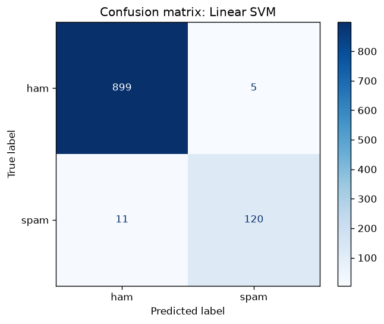

# 📩 SMS Spam Classifier

A machine learning model that detects spam text messages, trained on the [UCI SMS Spam Collection](https://archive.ics.uci.edu/dataset/228/sms+spam+collection) dataset. It compares three classic text classifiers, saves the best one, and includes a command-line tool to classify your own messages.


## Results

Evaluated on a held-out, stratified 20% test set (1,035 messages):

| Model | Accuracy | Precision | Recall | F1 (spam) |
|---|---|---|---|---|
| Naive Bayes | 0.983 | 0.967 | 0.893 | 0.929 |
| Logistic Regression | 0.982 | 0.938 | 0.916 | 0.927 |
| **Linear SVM** ✅ | **0.985** | **0.960** | **0.916** | **0.938** |

The **Linear SVM** is selected and saved. Out of 904 real messages, only 5 were wrongly flagged as spam, and it caught 120 of 131 spam messages.



## How it works

1. **Data:** 5,574 SMS messages labelled `ham` or `spam`. After removing duplicates, 5,171 remain (12.6% spam).
2. **Features:** TF-IDF on word unigrams and bigrams, with sublinear term frequency so repeated words like "FREE FREE FREE" don't dominate.
3. **Models:** Multinomial Naive Bayes, Logistic Regression and a Linear SVM, each in a scikit-learn `Pipeline`.
4. **Selection:** the model with the best **F1 score on the spam class** wins. Spam is the minority class, so F1 is a fairer measure than accuracy: a model that labels everything as ham would still score 87% accuracy.

## Getting started

```bash
git clone https://github.com/saib28/spam-classifier.git
cd spam-classifier
python -m venv .venv
.venv\Scripts\activate          # Windows  (macOS/Linux: source .venv/bin/activate)
pip install -r requirements.txt
```

**Train** (downloads the dataset automatically on first run):

```bash
python src/train.py
```

**Classify messages:**

```bash
python src/predict.py "Free entry in 2 a wkly comp to win FA Cup final tkts. Text FA to 87121"
# SPAM  |  Free entry in 2 a wkly comp to win FA Cup final tkts. Text FA to 87121

python src/predict.py "Can you send me the lecture notes from today?"
#  ham  |  Can you send me the lecture notes from today?

python src/predict.py   # interactive mode
```

**Run tests:**

```bash
pytest
```

## Project structure

```
spam-classifier/
├── src/
│   ├── data.py       # download + load the dataset
│   ├── train.py      # train, compare and save models
│   └── predict.py    # command-line classifier
├── tests/
│   └── test_model.py
├── reports/          # metrics.json + confusion matrix
└── requirements.txt
```

## Possible next steps

- Fine-tune a transformer (e.g. DistilBERT) and compare it with these baselines
- Add a simple web UI with Streamlit
- Tune the decision threshold to trade off missed spam against false alarms

## Dataset

Almeida, T. & Hidalgo, J. (2011). *SMS Spam Collection* [Dataset]. UCI Machine Learning Repository. https://doi.org/10.24432/C5CC84. Licensed under CC BY 4.0.

## License

[MIT](LICENSE)
